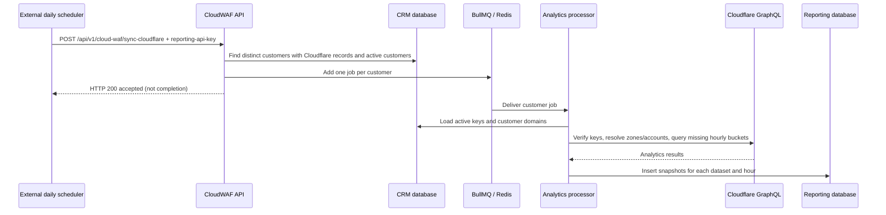

# CloudWAF Analytics and IoC Synchronization Specification

## Purpose

The CloudWAF feature integrates customer Cloudflare accounts with Webyith Reporting. It has two separate workflows:

- **Analytics synchronization:** a daily scheduler calls the CloudWAF trigger API. The API queues one job per customer, and a BullMQ processor fetches Cloudflare GraphQL analytics and stores hourly snapshots in the Reporting database.
- **IoC synchronization:** an independent queue workflow reads active TAXII feeds and writes IP/hostname lists and firewall rules to Cloudflare. It does not populate the analytics snapshot tables described below.

The CloudWAF API also serves analytics to clients. For most analytics endpoints, a one-day request is fetched live from Cloudflare while longer periods are assembled from the Reporting snapshots.

## Components and Boundaries

| Component                                | Responsibility                                                                                                                                               |
| ---------------------------------------- | ------------------------------------------------------------------------------------------------------------------------------------------------------------ |
| External scheduler                       | Calls `POST /api/v1/cloud-waf/sync-cloudflare` on its configured daily schedule. The CloudWAF module does not define this daily cron expression or timezone. |
| `CloudWAFController` / `CloudWAFService` | Exposes the trigger, analytics, security-rules, and IoC endpoints. Queues customer sync jobs and selects live or cached analytics data.                      |
| `SyncCloudflareWorkerProcessor`          | Consumes the daily analytics queue and delegates each customer job to the sync engine.                                                                       |
| `SyncCloudflareWorkerEngine`             | Validates customer Cloudflare keys, matches customer domains to zones, queries Cloudflare GraphQL, and persists hourly snapshots.                            |
| `CloudflareService`                      | Shared Cloudflare integration for token validation, account/zone discovery, GraphQL, and Cloudflare REST calls.                                              |
| CRM database                             | Supplies customers, their Cloudflare API keys, and customer domains.                                                                                         |
| Reporting database                       | Stores Cloudflare analytics snapshots and TAXII feed configuration/sync state.                                                                               |
| `SyncCloudflareIocWorkerProcessor`       | Consumes the separate IoC queue and syncs TAXII feed indicators to Cloudflare Lists/firewall rules.                                                          |

## Daily Analytics Sync

### Scheduler and Trigger

The scheduler boundary is external: `POST /api/v1/cloud-waf/sync-cloudflare` is the trigger endpoint, but there is no `@Cron` method in the CloudWAF module for this daily analytics flow. The deployment scheduler owns the frequency and timezone; neither is specified by the module.

The route is covered by the global Reporting API key guard and expects the `reporting-api-key` header. It has no request body. The controller starts `syncCloudflare()` without awaiting it and returns a success response immediately. This indicates that the trigger was accepted; it does not mean queueing or synchronization has completed. The response has no job ID or per-customer completion status.

The trigger selects distinct customer IDs from CRM `customerCloudflare` records whose related customer is active. Key activity/validity is checked later by the worker. It enqueues one job per selected customer, using a job ID containing the customer ID and current time slot. Repeated triggers within the same slot can therefore encounter an existing job ID.

### Queue and Processor Contract

| Property              | Current behavior                                                                                                                                                                          |
| --------------------- | ----------------------------------------------------------------------------------------------------------------------------------------------------------------------------------------- |
| Queue name            | `reporting.daily.cloudflare.sync` (`SYNC_CLOUDFLARE_DAILY_WORKER`)                                                                                                                        |
| Job name              | `reporting.daily.cloudflare.sync`                                                                                                                                                         |
| Job payload           | `{ customerId: "<customer UUID>" }`                                                                                                                                                       |
| Job ID                | `sync-cloudflare-<customerId>-<time-slot>`                                                                                                                                                |
| Batch scope           | One customer per job; the processor handles its zones and datasets sequentially                                                                                                           |
| Processor concurrency | 5 customer jobs per processor instance                                                                                                                                                    |
| Worker entrypoint     | Master worker process, through `SyncCloudflareWorkerModule`                                                                                                                               |
| Error handling        | Uncaught processor errors are captured by `errorAdapter` and rethrown to BullMQ. Individual dataset fetch methods may log and continue, so a job can finish with partial dataset results. |

The queue uses the shared `BASE_QUEUE_OPTIONS`; retry/retention settings should be checked there rather than inferred from the CloudWAF module.

### Customer and Zone Selection

For each job, the engine:

1. Loads active Cloudflare API keys for the customer, requiring the customer to remain active. If no active keys exist, the job exits without fetching data.
2. Loads the customer's domains. If none exist, the job exits.
3. Verifies the keys with Cloudflare. Non-valid keys are logged; verification results update the CRM key's `isActive` and `lastModified` fields when verification was not skipped. If no valid keys remain, the job exits.
4. Resolves Cloudflare zones and accounts accessible to the valid keys. Zones are retained when their Cloudflare zone name matches a CRM customer domain.
5. For each matching zone, synchronizes firewall analytics, HTTP versions, bandwidth, content types, allowed requests, mitigated requests, request volume, and (when RUM is enabled) Core Web Vitals.

### Snapshot Window and Persistence

The engine keeps a rolling 30-day window (`NUMBER_OF_DAYS_TO_STORE = 30`) and stores data in one-hour intervals (`TIME_SLOT_DURATION = 1`). For each zone and dataset it checks which hourly buckets are present, queries missing buckets, and inserts the results. Older rows are deleted during the dataset sync. Existing hourly rows are treated as already synchronized rather than refreshed on every run.

| Reporting Prisma model        | Data stored per zone/hour                                                                                                                                             |
| ----------------------------- | --------------------------------------------------------------------------------------------------------------------------------------------------------------------- |
| `CloudflareThreads`           | Firewall events grouped by country, action, and source, with request counts                                                                                           |
| `CloudflareHttpVerions`       | HTTP protocol/version request counts (model spelling follows the existing schema)                                                                                     |
| `CloudflareBandwidth`         | Total bytes and cached bytes                                                                                                                                          |
| `CloudflareContentTypes`      | Content-type analytics, including counts and byte totals                                                                                                              |
| `CloudflareAllowedRequests`   | Allowed requests grouped by country                                                                                                                                   |
| `CloudflareMitigatedRequests` | Mitigated requests grouped by country                                                                                                                                 |
| `CloudflareCoreWebVitals`     | LCP sample totals, good/needs-improvement/poor counts, percentiles, time series, and JSON breakdowns by URL, browser, OS, country, and element                        |
| `CloudflareRequestVolume`     | Ranked JSON breakdowns across 18 request dimensions, including referers, paths, hosts, browsers, countries, methods, ASNs, IPs, cache statuses, and protocol versions |

Cloudflare RUM Web Vitals is account-scoped rather than zone-scoped. The engine resolves a RUM site tag for a zone and skips that zone's Core Web Vitals sync when RUM is not enabled. The stored row still carries the Cloudflare zone ID so the API can scope the returned data to requested customer domains.

## Analytics and Security APIs

All analytics routes are served by `CloudWAFController` at `/api/v1/cloud-waf/...`; there is not a second feature module exposing these same analytics snapshots. The routes require the global `reporting-api-key` header. Successful responses use the standard API response envelope (`success`, `messages`, `data`, and `timestamp`).

Most analytics request bodies include `customerId`, `domains`, and `periodDay` (1-30). The shared DTO validates domains as strings and the period as a bounded number. Some newer LCP/request-volume DTOs make `periodDay` optional and apply endpoint-specific defaults. `security-rules` instead takes `customerId` and one `domain`.

| Endpoint                                  | Data returned                                                                | Read path                                                                                    |
| ----------------------------------------- | ---------------------------------------------------------------------------- | -------------------------------------------------------------------------------------------- |
| `POST /threats-by-country`                | Firewall events by domain, country, action, and source                       | Live Cloudflare GraphQL for `periodDay=1`; Reporting snapshots for longer periods            |
| `POST /http-version-used`                 | Request counts grouped by HTTP protocol version                              | Live for one day; Reporting snapshots for longer periods                                     |
| `POST /bandwidth-saved`                   | Total and cached bandwidth over time                                         | Live for one day; Reporting snapshots for longer periods                                     |
| `POST /content-type-breakdown`            | Content-type request/byte breakdown                                          | Live for one day; Reporting snapshots for longer periods                                     |
| `POST /top-allowed-requests-by-country`   | Allowed request counts by country                                            | Live for one day; Reporting snapshots for longer periods                                     |
| `POST /top-mitigated-requests-by-country` | Mitigated request counts by country                                          | Live for one day; Reporting snapshots for longer periods                                     |
| `POST /lcp-overview`                      | Core Web Vitals summary, time series, and combined breakdowns                | Live Cloudflare RUM for one day; `CloudflareCoreWebVitals` snapshots for longer periods      |
| `POST /lcp-url`                           | LCP breakdown by URL                                                         | Live for one day; stored JSON breakdowns for longer periods                                  |
| `POST /lcp-browser`                       | LCP breakdown by browser                                                     | Live for one day; stored JSON breakdowns for longer periods                                  |
| `POST /lcp-os`                            | LCP breakdown by operating system                                            | Live for one day; stored JSON breakdowns for longer periods                                  |
| `POST /lcp-country`                       | LCP breakdown by country                                                     | Live for one day; stored JSON breakdowns for longer periods                                  |
| `POST /lcp-element`                       | LCP breakdown by page element                                                | Live for one day; stored JSON breakdowns for longer periods                                  |
| `POST /requests-volume-by-source`         | Request-volume rankings across the supported dimensions                      | Live for one day; `CloudflareRequestVolume` snapshots for longer periods                     |
| `POST /requests-volume-top-n`             | Expanded top-N results for one allowlisted request-volume dimension          | Live for one day; stored request-volume JSON for longer periods                              |
| `POST /security-rules`                    | Zone security-rule sections, status/actions, and supported rule event series | Live Cloudflare configuration and analytics calls; not served from the daily snapshot tables |

`requests-volume-top-n` accepts an allowlisted `scope` and an optional `limit` (1-1000, default 50). The overview endpoint returns bounded per-scope lists; the top-N route supports expanding one dimension.

`periodDay=1` is deliberately a live read path and does not wait for the background queue. Periods greater than one day depend on the snapshot window and available hourly rows. For LCP, Cloudflare RUM must be enabled for the requested domain; otherwise the API returns empty data with an explanatory message.

### Trigger and IoC Support APIs

These CloudWAF routes are operational/support endpoints, separate from analytics reads:

| Endpoint                             | Purpose                                                                                                                                                  |
| ------------------------------------ | -------------------------------------------------------------------------------------------------------------------------------------------------------- |
| `POST /sync-cloudflare`              | Queue daily analytics synchronization for customers                                                                                                      |
| `POST /ioc-sync/resync`              | Queue an IoC synchronization for a specified customer and TAXII feed; returns a job ID                                                                   |
| `GET /ioc-sync/resync/status/:jobId` | Poll the queued IoC job status and progress steps                                                                                                        |
| `POST /ioc-sync/sync-all`            | Queue IoC jobs for active feeds/customers with active Cloudflare keys; the controller describes this as the same action as the six-hourly scheduled sync |
| `POST /ioc-sync/check-permissions`   | Test whether a customer's Cloudflare credentials can create/edit the Lists and firewall rules required by IoC sync                                       |
| `POST /ioc-sync/verify-key`          | Lightweight check for a valid Cloudflare key; does not test write permissions                                                                            |

The IoC workflow has a separate queue (`reporting.cloudflare.ioc.sync`) and processor concurrency of 3. It reads active TAXII feed configuration from Reporting, fetches indicators, and writes Cloudflare Lists/firewall rules. Its scheduled trigger is not implemented as a CloudWAF `@Cron` method; the six-hour cadence is a scheduler/deployment responsibility. This workflow does not write the analytics snapshot models above.

## Related Modules and Data Ownership

| Module/service                | Relationship to CloudWAF data                                                                                                                                                                               |
| ----------------------------- | ----------------------------------------------------------------------------------------------------------------------------------------------------------------------------------------------------------- |
| `crm/customerCloudflare`      | Owns APIs and CRM records for managing customer Cloudflare keys. These are credentials/configuration inputs, not analytics response endpoints.                                                              |
| `shared/3rd-party/cloudflare` | Provides Cloudflare token verification, zone/account/RUM discovery, GraphQL calls, and REST operations used by both workers and API reads.                                                                  |
| `cloudWAF`                    | Owns the analytics response APIs and reads snapshots through `ReportingPrismaService`; for one-day reads it may call Cloudflare live.                                                                       |
| `clean-up`                    | Removes Cloudflare reporting rows as part of customer/domain cleanup; it is not an analytics API provider.                                                                                                  |
| `recommendation`              | Uses Cloudflare findings as an input to recommendation calculation through the shared Cloudflare integration. It does not serve the CloudWAF analytics endpoints or calculate the CloudWAF snapshot tables. |
| `threatfeeds`                 | Owns TAXII collection configuration/data used by the separate Cloudflare IoC sync flow. It is not the producer of the daily Cloudflare analytics snapshots.                                                 |

In short, client requests for these Cloudflare analytics are routed to `CloudWAFController`. The other modules supply credentials, shared Cloudflare access, feed data, or cleanup behavior; they do not provide alternate API routes for these same analytics tables.

## Operational Notes

- API, Redis/BullMQ, the master worker, CRM, Reporting, and Cloudflare must be reachable for a full background sync.
- A trigger response is not a completion signal. There is no per-customer analytics status endpoint in the current CloudWAF API.
- A customer job can be a no-op when it has no active key, no domains, no valid key, or no matching Cloudflare zones.
- GraphQL failures are logged in dataset-specific methods; some methods allow the remaining datasets/zones to proceed. Treat persisted analytics as potentially partial when upstream calls fail.
- The 30-day window is a data-retention boundary for these sync methods, not a guarantee that every hourly bucket exists. Cloudflare plan, permissions, RUM configuration, and upstream data availability can affect coverage.
- Never log or expose Cloudflare API key values. CRM key-management and Cloudflare routes must remain behind the application's API key guard.

## Implementation References

- API routes and module wiring: `../../../src/modules/cloudWAF/cloudWAF.controller.ts`, `../../../src/modules/cloudWAF/cloudWAF.module.ts`
- Triggering and analytics read paths: `../../../src/modules/cloudWAF/cloudWAF.service.ts`
- Daily queue worker and persistence engine: `../../../src/modules/cloudWAF/worker/sync-cloudflare-worker.processor.ts`, `../../../src/modules/cloudWAF/worker/sync-cloudflare-worker.enginee.ts`
- Separate IoC worker: `../../../src/modules/cloudWAF/worker/sync-cloudflare-ioc-worker.processor.ts`, `../../../src/modules/cloudWAF/worker/sync-cloudflare-ioc-worker.engine.ts`
- Cloudflare reporting models: `../../../src/core/databases/reporting/prisma/schema.prisma`
- Shared queue names: `../../../src/core/queues/bullmq/bullmq.constants.ts`
- Master worker registration: `../../../src/workers/master/master-worker.module.ts`
