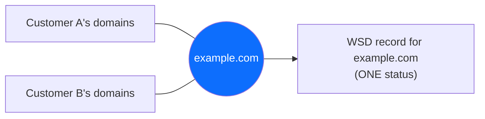
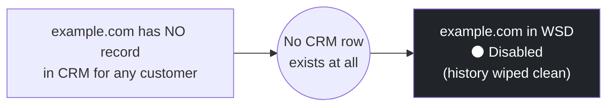
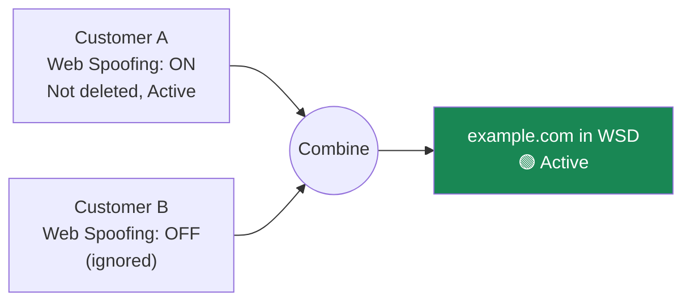
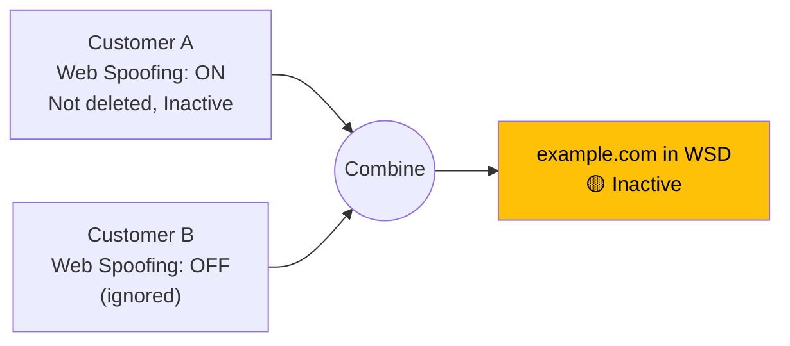
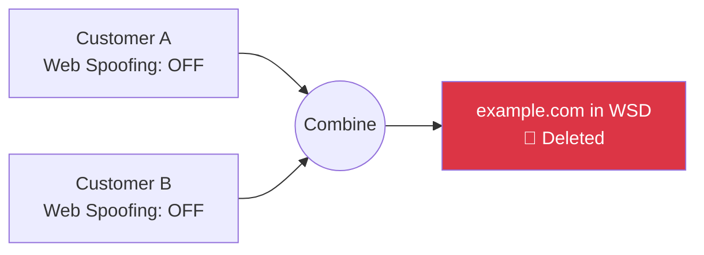
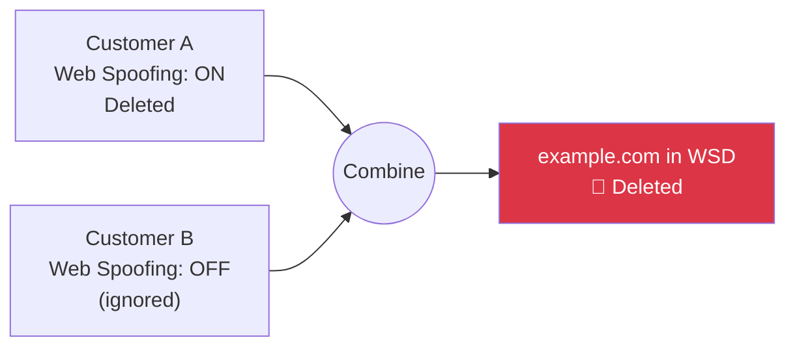

# CRM → WSD Domain Sync — Case by Case

CRM and WSD each keep their own separate record of "domain" and "customer" - they are not the
same data:

|              | CRM                                                                                                                                                                                     | WSD                                                                         |
| ------------ | --------------------------------------------------------------------------------------------------------------------------------------------------------------------------------------- | --------------------------------------------------------------------------- |
| **Domain**   | One row **per customer that owns it** - the same domain can appear multiple times, once per customer, each with its own settings (Web Spoofing on/off, active/inactive, deleted or not) | One row **per domain, period** - no customer attached, just a single status |
| **Customer** | Customer accounts exist here; each one can own any number of domains                                                                                                                    | Customer doesn't exist as a concept here at all                             |

So when `example.com` is owned by 2 different customers in CRM, that's 2 separate CRM rows with
possibly different settings - but only ever 1 row in WSD. Sync's job is to combine those CRM
rows into that 1 WSD row's status: Disabled / Active / Inactive / Deleted.

**The 3 CRM settings that decide the outcome, per owning customer:**

1. **Web Spoofing toggle** - `Dashboard > Settings > Service Configuration > Web Spoofing
column`. If this is OFF, that customer is ignored completely - none of their other settings
   matter.
2. **Active / Inactive** - that customer's own on/off switch for the domain (only counted if
   Web Spoofing above is ON).
3. **Deleted** - that customer has removed the domain from their account (only counted if Web
   Spoofing above is ON).

---

## Case 1 — Disabled

**Criteria:** the domain **doesn't exist in CRM at all** - no customer has a record of it, not
even with Web Spoofing off. This is different from every other case below, where at least one
customer still has the domain in CRM.

Example: `example.com` has no record in CRM for any customer - whether it was removed at some
point or simply was never added for anyone currently in CRM doesn't matter, only that it isn't
there now.

→ **Result in WSD: Disabled.** History (removal date, who removed it) is wiped clean - so if
`example.com` is ever added to a customer's account in CRM later, it starts fresh instead of
carrying old data.

---

## Case 2 — Active

**Criteria:** at least one owning customer has **Web Spoofing ON**, **not deleted**, and
**Active** (in CRM).

Example: `example.com` belongs to Customer A (Web Spoofing **ON**, not deleted, **Active**) and
Customer B (Web Spoofing **OFF**).

→ **Result in WSD: Active.** One customer meeting all 3 criteria is enough, regardless of what
Customer B is doing.

---

## Case 3 — Inactive

**Criteria:** at least one owning customer has **Web Spoofing ON** and **not deleted**, but
_every_ customer who meets those two is set to **Inactive** (in CRM).

Example: `example.com` belongs to Customer A (Web Spoofing **ON**, not deleted, **Inactive**)
and Customer B (Web Spoofing **OFF**).

→ **Result in WSD: Inactive** (not Deleted - going Inactive is not the same as deleting).

---

## Case 4 — Deleted

Two different criteria both lead here:

**4a. Nobody has Web Spoofing on at all**

Example: `example.com` belongs to Customer A and Customer B, both with Web Spoofing **OFF**.

→ **Result in WSD: Deleted.** (If it wasn't in WSD yet, nothing happens.)

**4b. Someone has Web Spoofing on, but every one of them has deleted the domain**

Example: `example.com` belongs to Customer A (Web Spoofing **ON**, **Deleted**) and Customer B
(Web Spoofing **OFF**, so they don't count).

→ **Result in WSD: Deleted.**

---

**Rule of thumb:** if even ONE customer has Web Spoofing on, the domain counts as eligible.
"Deleted" only happens when EVERY customer with Web Spoofing on has deleted it (4b), or nobody
has Web Spoofing on at all (4a) - one customer with Web Spoofing on and not deleted always keeps
it alive.

**Where you see this in the product:** Domain Management page status badges (green = Active,
yellow = Inactive, red = Deleted, black = Disabled), and the Sync Run Detail modal after clicking
Sync.
