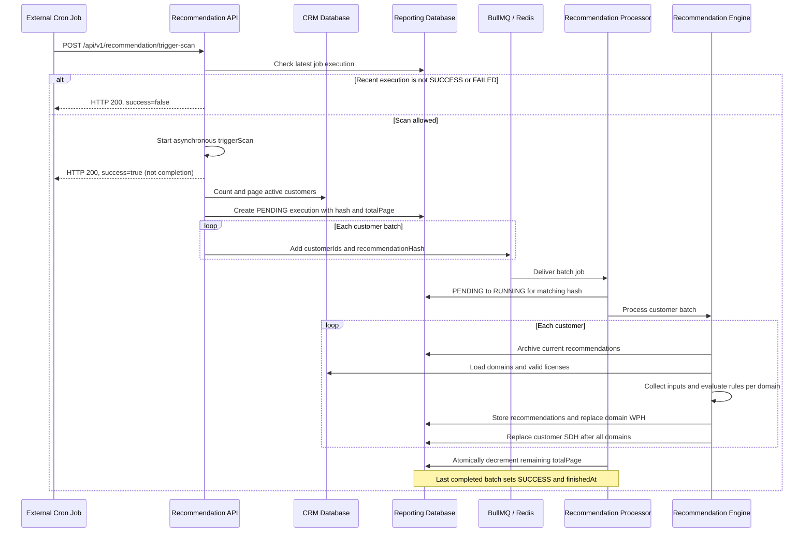

# Recommendation and Domain Health Specification

## Purpose

The recommendation feature evaluates customer domains using configured calculation
rules and produces three related datasets:

- **Recommendations:** rule-level findings, quantities, scores, and remediation text.
- **Web Presence Health (WPH):** a domain-level health score derived from its recommendations.
- **Service Domain Health (SDH):** a health score for each domain and service, excluding VAPT.

This document describes the current implementation. "Web Presence Health" is the
implementation's name for the web health dataset.

## Scan Scope and Processing Order

The scan selects all active CRM customers and partitions them into queue jobs. Each
job contains customer IDs and a shared `recommendationHash` identifying the scan.
The default batch size is 10 customers; the trigger request can override it.

For each customer, the worker loads active, non-deleted domains, current active
licenses, and active calculation rules. WCM, WSD, CF, and VAPT rules are filtered
by license SKU prefixes. VAPT additionally requires the domain's VAPT capability.

The worker archives existing recommendations, generates rule results for each
eligible domain, calculates that domain's WPH, and then calculates SDH for the
customer after processing its domains. Current and historical datasets are stored
separately in the Reporting database.

## Scheduled Scan and Queue Lifecycle

### Scheduler Boundary

The scheduling workflow is: an external cron job calls
`POST /api/v1/recommendation/trigger-scan`, the API enqueues customer batches, and
the recommendation processor consumes those batches asynchronously. The module
does not define a recommendation cron expression or an in-process `@Cron` method.
The deployment scheduler owns the frequency and timezone; neither is specified by
this implementation. The queue's `daily` name alone does not establish a schedule.

The scheduler must use the reporting API key and send a positive integer `limit`
when overriding the batch size. A scan recalculates recommendations from available
reporting/WSD data and Cloudflare/HTTPS observations; it does not enqueue a fresh
WCM or WSD domain scan.



### Trigger Behavior

1. Read the most recent execution for `reporting.daily.recommendation`.
2. Reject the trigger at the business level if that execution is neither
   `SUCCESS` nor `FAILED` and started within the last five minutes.
3. Generate `recommendationHash = Date.now().toString()`.
4. Count active customers and calculate `totalPage = ceil(customerCount / limit)`.
5. Create a `PENDING` job execution whose metadata contains the hash and page count.
6. Enqueue one job per customer page, visiting pages from the last page to the first.

The controller does not await `triggerScan()`. A successful HTTP response means the
preflight check allowed the trigger, not that enqueueing or calculation succeeded.
The trigger response includes neither a BullMQ job ID nor the scan hash.

### Queue and Processor Contract

| Property                 | Current value / behavior                                                                            |
| ------------------------ | --------------------------------------------------------------------------------------------------- |
| Queue                    | `reporting.daily.recommendation`                                                                    |
| Job name                 | `reporting.daily.recommendation.customer`                                                           |
| Job payload              | `{ customerIds: [{ id: "<customer UUID>" }], recommendationHash: "<epoch milliseconds>" }`          |
| Default batch size       | 10 active customers per job, not a limit on total scan scope                                        |
| Processor                | `RecommendationWorkerProcessor`, loaded by the master worker module                                 |
| Concurrency              | 5 batch jobs per processor instance; customers and domains within a batch run sequentially          |
| Attempts                 | 1, so failed jobs are not automatically retried by these job options                                |
| Successful batch         | Atomically decrements `metadata.totalPage`, which becomes a remaining-batch counter                 |
| Final successful batch   | Sets execution status to `SUCCESS` and populates `finishedAt`                                       |
| Uncaught processor error | Captured and rethrown to BullMQ; the processor does not explicitly set execution status to `FAILED` |

API, Redis/BullMQ, the master worker, and the relevant databases must be available
for the complete workflow. The `Remediated` recommendation status must exist:
without it, the engine skips calculation even though the batch can complete.

## Customer Eligibility and Input Data

Only CRM customers with `isActive = true` are initially selected. For each customer:

- Domains must be active and have `deleteFlag = false`.
- Domain URLs are loaded with `deleteFlag = false`; inactive URLs remain inputs
  because unmonitored URLs are themselves a recommendation condition.
- A customer license must be active, within its inclusive start/end dates, and
  reference an active license definition.
- Calculation rules must have `isActived = true`.

| Rule service | Required license SKU prefix | Domain-specific gating                                           |
| ------------ | --------------------------- | ---------------------------------------------------------------- |
| WCM          | `WCM`                       | Rules inspect capability, URL configuration, and metrics         |
| WSD          | `WSD`                       | Rules inspect capability, threat counts, and registration trends |
| CF           | `CF`                        | Cloudflare findings are matched to the domain                    |
| VAPT         | `VAPT` or `PT`              | All VAPT rules are removed when `capabilityVapt` is false        |

Unknown service names pass the license filter, but the scoring dispatcher returns
a zero-score, zero-quantity result for them.

| Input                                         | Source and use                                                                                                                                    |
| --------------------------------------------- | ------------------------------------------------------------------------------------------------------------------------------------------------- |
| CRM domains, URLs, capabilities, and licenses | Determine scope and rule eligibility                                                                                                              |
| WCM metrics                                   | Reporting database, ordered by newest `createdDate`, distinct by domain and metric type; the engine uses the first matching metric for the domain |
| WSD threat counts                             | `WsdDomainStatsService.domainStats`, with `lookbackDays = 1`, provides `ttlPotentialThreat` and `ttlMalicious`                                    |
| WSD registrations                             | WSD v2 database, registered fuzzer domains and WHOIS creation dates over a 180-day window                                                         |
| Cloudflare                                    | Customer API token validation and domain/zone recommendations; duplicate finding IDs are removed per domain                                       |
| HTTPS security                                | HTTPS request to the domain collects certificate issuer, TLS cipher/version, and HSTS header when VAPT rules are eligible                         |

Cloudflare zone synchronization can create CRM domains or clear their deletion
flag. Because the engine has already loaded the customer's domain list, those
changes are not reloaded for the current customer's scan.

## Recommendation Scoring

### Score Meaning and Normalization

A recommendation score is a **penalty**, not a health rating. A larger score
represents a larger contribution to reducing health. `quantity` represents the
rule's finding count or trigger indicator and is not always a domain/URL count.

For each domain, compute a service denominator from its eligible calculation rules:

$$
F_s = \sum_{r \in R_s} b_r
$$

Here, $R_s$ is the eligible rule set for service $s$, and $b_r$ is a truthy
`rule.maxScore` when configured, otherwise `rule.score` (or zero).

For a raw rule penalty $x_r$:

$$
C_r =
\begin{cases}
\min(x_r, m_r), & \text{when maxScore } m_r \text{ is truthy} \\
x_r, & \text{otherwise}
\end{cases}
$$

$$
P_r =
\begin{cases}
\operatorname{round}_2(100 C_r / F_s), & F_s \ne 0 \\
100 C_r, & F_s = 0
\end{cases}
$$

`P_r` is the stored recommendation `score`. Normalized scores are rounded to two
decimal places, except the zero-denominator branch. Most count-based rules use
`x_r = rule.score * quantity`; exceptions are described below. Weights and caps
come from the database rather than hard-coded weights in this document.

For example, a rule weight of 5, quantity 3, cap 10, and service denominator 40
produce a raw penalty of 15, capped penalty of 10, and stored score of 25.

### WCM Rules

| Code  | Trigger and quantity                                                                                                                          | Raw penalty                             |
| ----- | --------------------------------------------------------------------------------------------------------------------------------------------- | --------------------------------------- |
| WCM01 | Count inactive, non-deleted URLs for an active customer. If the domain has no URLs, emit one finding with a synthetic domain URL in metadata. | `rule.score * quantity`                 |
| WCM02 | Active customer/domain has `capabilityWcm = false`; quantity 1.                                                                               | `rule.score`                            |
| WCM03 | At least one URL has `urlType = 0`, the customer has the exact SKU `WCM-5M`, and customer/domain are active; quantity 1.                      | `rule.score`                            |
| WCM04 | Selected WCM metric is `OUTAGE` and customer is active; quantity is the number of loaded URLs, or 1 when none exist.                          | `rule.score * quantity`                 |
| WCM05 | Selected WCM metric is `WEB_DEFACEMENT` and customer is active; same quantity rule as WCM04.                                                  | `rule.score * quantity`                 |
| WCM07 | Threat-search input has a positive `urlCount`; quantity 1.                                                                                    | `urlCount`, not `rule.score * urlCount` |

WCM03 does not compare a measured monitoring frequency against a threshold; its
current trigger is the configuration/SKU condition above. WCM06 has no explicit
calculator branch and therefore returns zero.

### WSD Rules

| Code  | Trigger and quantity                                                                                        | Raw penalty                       |
| ----- | ----------------------------------------------------------------------------------------------------------- | --------------------------------- |
| WSD01 | Active customer/domain has `capabilityWsd = false`; quantity 1.                                             | `rule.score`                      |
| WSD02 | Active customer/domain has a positive `ttlPotentialThreat`; quantity is that count.                         | `rule.score * ttlPotentialThreat` |
| WSD03 | Active customer/domain has a positive `ttlMalicious`; quantity is that count.                               | `rule.score * ttlMalicious`       |
| WSD06 | Threat-search input has a positive `domainCount`; quantity is that count; metadata includes fuzzer domains. | `rule.score * domainCount`        |
| WSD07 | Positive registration-trend penalty for today versus the 180-day baseline; quantity 1.                      | Trend penalty below               |
| WSD08 | Positive registration-trend penalty for the previous 7 days versus the 180-day baseline; quantity 1.        | Trend penalty below               |
| WSD09 | Positive registration-trend penalty for the previous 30 days versus the 180-day baseline; quantity 1.       | Trend penalty below               |

WSD04 and WSD05 have no explicit calculator branch and return zero. The current
engine initializes the threat-search input map as empty and does not populate it,
so WSD06 and WCM07 currently produce zero through this execution path.

For WSD07/08/09, the source query counts registered WSD rows by WHOIS creation date:

- `avg1`: today's count, between database day boundaries.
- `avg7`, `avg30`, `avg180`: preceding-period counts divided by 7, 30, or 180;
  their windows exclude today and use strict time boundaries.
- The SQL uses integer division for those averages.
- Registration lists stored in metadata are deduplicated after the query; the
  counts used for scoring are row counts, not distinct-domain counts.

Let $\Delta$ be `avg1 - avg180`, `avg7 - avg180`, or `avg30 - avg180`:

| Difference           | Raw trend penalty |
| -------------------- | ----------------- |
| $\Delta \le 2$       | 0                 |
| $2 < \Delta < 10$    | 2                 |
| $10 \le \Delta < 20$ | 3                 |
| $20 \le \Delta < 30$ | 5                 |
| $\Delta \ge 30$      | 15                |

The raw trend penalty is normalized using the WSD denominator and the rule cap.
When positive, metadata contains the relevant registration list in `newRegistered`.
Recommendation text substitutes the corresponding average and the current date.

### Cloudflare Rules

CF01 emits one recommendation per Cloudflare finding whose `subject` matches the
domain. The finding's message becomes recommendation text. Metadata includes the
domain ID, URLs, account IDs, issue type/class, severity, and finding payload.

| Severity, case-insensitive | Raw penalty |
| -------------------------- | ----------- |
| `low`                      | 1           |
| `moderate`                 | 3           |
| `critical`                 | 10          |
| Any other value            | 0           |

Each finding has quantity 1 and is normalized independently. Multiple CF findings
can accumulate beyond a single rule's nominal cap because the cap applies per
finding, not to their combined sum. An empty finding array emits no CF01 rows.

There is a separate invalid-token path: when the customer has Cloudflare key
records but none validates, and an eligible CF01 rule exists, it inserts one
"All Cloudflare API keys are invalid" recommendation per active customer domain.
Its stored score is `CF01.maxScore` when truthy, otherwise zero, **without percentage
normalization**. No stored keys is treated as passing this validation check.

### VAPT Rules

| Code | Calculator condition                                        | Raw penalty / quantity                                                                                      |
| ---- | ----------------------------------------------------------- | ----------------------------------------------------------------------------------------------------------- |
| PT01 | Active customer/domain lacks VAPT capability.               | `rule.score`, quantity 1; unreachable in the current engine because VAPT rules are removed for such domains |
| PT02 | Neither TLS 1.3 nor TLS 1.2 with an accepted strong cipher. | `rule.score`, quantity 1                                                                                    |
| PT03 | Certificate issuer organization equals `Let's Encrypt`.     | `rule.score`, quantity 1                                                                                    |
| PT04 | HSTS header does not contain `max-age`.                     | `rule.score`, quantity 1                                                                                    |

PT02 accepts TLS 1.2 only when the cipher name includes DHE/ECDHE and
AES_128_GCM, AES_256_GCM, or CHACHA20, and contains none of the rejected markers:
RC4, MD5, DES, SEED, IDEA, NULL, EXP, PSK, or SRP. TLS 1.3 is accepted directly.
PT03 is an implementation-specific issuer rule, not a general assertion that this
issuer is insecure. If HTTPS collection fails, it returns null; PT02 and PT04 then
produce findings because their accepted conditions cannot be verified.

### Stored Recommendation Record

Each result includes `customerId`, `recommendationHash`, `ruleId`, `text`,
`quantity`, `score`, `statusId`, and JSON `serviceMetadata`. Supported rule metadata
normally contains `customerDomainId` and domain URLs. Records are created even for
zero-score/zero-quantity results, except array-returning rules with no findings.

New records use the configured `Remediated` status, including records with positive
quantity. The current list API selects by quantity, not by an `Open` status.

## Web Presence Health

WPH is calculated after storing recommendations for each domain. The service
selects recommendations for the customer and current scan hash, then keeps records
whose `serviceMetadata.customerDomainId` matches the domain.

For every service represented in those records:

$$
H_{d,s} = 100 - \sum_{r \in R_{d,s}} P_r
$$

The domain's WPH is an equally weighted average of those service health values:

$$
\operatorname{WPH}_d = \operatorname{round}_1\left(
\frac{\sum_{s \in S_d} H_{d,s}}{|S_d|}
\right)
$$

- Higher WPH means better health.
- VAPT contributes when its recommendations are present; unlike SDH, WPH does not
  explicitly exclude it.
- Services with no recommendation records do not enter the average. A zero-penalty
  record still represents its service and contributes a service health of 100.
- No matching recommendations means no new WPH record, not an automatic score of 100.
- The result is rounded to one decimal place and is not clamped to 0-100.

WPH metadata is an array of rule penalties, for example
`[{ "rule": "WCM01", "score": 25 }, { "rule": "WSD02", "score": 10 }]`.
The record also stores customer ID, domain ID, hash, and `lastScan` copied from the
first selected recommendation.

## Service Domain Health

After processing all domains for a customer, the service archives existing SDH and
queries each configured recommendation service other than VAPT. Recommendations
are restricted to that customer, service, and current scan hash. Results with a
missing or malformed domain UUID in metadata are skipped, then grouped by domain.

$$
\operatorname{SDH}_{d,s} = \operatorname{round}_1\left(
100 - \sum_{r \in R_{d,s}} P_r
\right)
$$

Each record stores customer ID, domain ID, service ID, hash, `lastScan`, and the
same `{ rule, score }` metadata format as WPH, restricted to that service/domain.
No eligible records means no SDH row. The score is not clamped to 0-100.

### Worked Health Example

For one domain, assume these stored recommendation penalties:

| Service | Penalty sum | Service health |
| ------- | ----------- | -------------- |
| WCM     | 25          | 75             |
| WSD     | 10          | 90             |
| CF      | 20          | 80             |
| VAPT    | 5           | 95             |

WPH is $(75 + 90 + 80 + 95) / 4 = 85.0$. SDH records are WCM 75, WSD 90,
and CF 80. No VAPT SDH record is generated. Without VAPT records, WPH would instead
be rounded from $(75 + 90 + 80) / 3$ to 81.7.

## Current Data, History, and Operational Limits

| Dataset         | Current Prisma model  | Historical Prisma model        |
| --------------- | --------------------- | ------------------------------ |
| Recommendations | `Recommendations`     | `RecommendationHistories`      |
| WPH             | `WebPresenceHealth`   | `WebPresenceHealthHistories`   |
| SDH             | `ServiceDomainHealth` | `ServiceDomainHealthHistories` |

Before replacement, current records are copied to history and deleted from the
current tables. Existing historical `isPreviousRun` flags are cleared and newly
archived records are marked as the previous run. History older than 30 days is
deleted by these archival methods for the relevant customer scope; cleanup happens
during scans, not through a recommendation-specific retention cron.

Important limitations of the current implementation:

- The five-minute trigger check is not a scan-wide lock. A long-running scan older
  than five minutes may overlap a new scan, and concurrent triggers can race.
- With no active customers, a PENDING execution is created with zero pages and no
  processor job exists to transition it to SUCCESS.
- Refresh is not atomic across the scan. During processing, readers can observe
  missing records or a mixture of customers from different scan hashes.
- Several scoring, health, and archival methods capture errors without rethrowing.
  A SUCCESS execution therefore does not guarantee every expected result was stored.
- SDH current/history duplicate checks use customer/service/scan-time information
  without domain ID. They are not a strict domain-aware uniqueness guarantee.
- The scan hash groups results, but `lastScan` comes from individual recommendation
  timestamps rather than a single guaranteed timestamp for the entire scan.
- No documented health-band classification or final range clamp exists in these
  calculators. Consumers should not assume a missing row means healthy.

## Data Retrieval APIs

### Common Contract

All paths below are for the reporting application. Send JSON bodies and headers:

```http
Content-Type: application/json
reporting-api-key: <REPORTING_API_KEY>
```

Responses use the global envelope:

```json
{
  "success": true,
  "messages": ["<operation message>"],
  "data": {},
  "metadata": {
    "page": 1,
    "limit": 10,
    "currentRecords": 1,
    "totalRecords": 1,
    "totalPages": 1,
    "hasNextPage": false,
    "hasPrevPage": false
  },
  "timestamp": "2026-11-03T02:00:00.000Z"
}
```

`metadata` is included only where the endpoint returns pagination metadata. The
examples below use fabricated IDs and domains. Successful reads return HTTP 200;
API key checks, validation, and global error handling still apply.

| Method | Path                                     | Purpose                               | Array key under `data`          |
| ------ | ---------------------------------------- | ------------------------------------- | ------------------------------- |
| POST   | `/api/v1/recommendation`                 | Current findings                      | `recommendations`               |
| POST   | `/api/v1/recommendation/history`         | Filtered historical findings          | `recommendationHistories`       |
| POST   | `/api/v1/recommendation/top`             | Three selected current findings       | `topRecommendations`            |
| POST   | `/api/v1/webpresencehealth`              | Current domain WPH and recent history | `webPresenceHealths`            |
| POST   | `/api/v1/webpresencehealth/history`      | WPH history by lookback days          | `webPresenceHealthHistories`    |
| POST   | `/api/v1/domainhealthbyservices`         | Current SDH across services           | `serviceDomainHealths`          |
| POST   | `/api/v1/domainhealthbyservices/history` | SDH history by lookback days          | `serviceDomainHealthHistories`  |
| POST   | `/api/v1/domainhealthbyservices/wcm`     | Current WCM SDH                       | `serviceDomainHealthsByService` |
| POST   | `/api/v1/domainhealthbyservices/wsd`     | Current WSD SDH                       | `serviceDomainHealthsByService` |
| POST   | `/api/v1/domainhealthbyservices/cf`      | Current CF SDH                        | `serviceDomainHealthsByService` |

### Trigger Scan API

`POST /api/v1/recommendation/trigger-scan`

```json
{
  "limit": 10
}
```

`limit` is the optional customer batch size; omit it to use 10. All active
customers are scanned regardless of this value. There is no customer/domain filter
in this trigger contract.

Allowed-trigger response:

```json
{
  "success": true,
  "data": {},
  "messages": [],
  "timestamp": "2026-11-03T02:00:00.000Z"
}
```

A recent nonterminal execution instead returns HTTP 200 with `success: false`,
empty data, and `messages: ["Another scan doesn't finished"]`. The scheduler must
inspect `success`, not only HTTP status. Neither response is a completion report.

### Current Recommendations

`POST /api/v1/recommendation`

```json
{
  "customerIds": ["11111111-1111-4111-8111-111111111111"],
  "page": 1,
  "limit": 10
}
```

`customerIds` scopes the query; an empty array returns no matches. Defaults are
`page = 1` and `limit = 10`. Only current rows with `quantity > 0` are returned,
including rows with zero score if their quantity is positive. The final list is
sorted by score descending, with alphabetical domain ordering when scores tie
and both domains resolve.

Example item in `data.recommendations`:

```json
{
  "id": "22222222-2222-4222-8222-222222222222",
  "recommendationHash": "1793671200000",
  "ruleId": "33333333-3333-4333-8333-333333333333",
  "customerId": "11111111-1111-4111-8111-111111111111",
  "text": "Initiate monitoring for example.com",
  "quantity": 1,
  "score": 25,
  "serviceMetadata": {
    "customerDomainId": "44444444-4444-4444-8444-444444444444",
    "customerDomainUrls": []
  },
  "domain": {
    "id": "44444444-4444-4444-8444-444444444444",
    "domain": "example.com",
    "isActive": true
  },
  "lastScan": "2026-11-03T02:00:00.000Z"
}
```

Items also include `statusId`, the related `status` object, and `rule` containing
`service`, `code`, configured `score`, and `maxScore`. Item `score` is the normalized
penalty; `rule.score` is the configured raw weight, not the same value.

**Pagination limitation:** this endpoint returns all matching rows. Database
`skip`/`take` are disabled, although pagination metadata is still calculated.

### Current Web Presence Health

`POST /api/v1/webpresencehealth`

Use the same `customerIds`, `page`, and `limit` body as the recommendation list.
Optional `selectedFields` selects persisted fields: `id`, `recommendationHash`,
`customerId`, `domainId`, `serviceMetadata`, `score`, and `lastScan`. Omit it for
the default full selection. If customizing it, keep `domainId: true` so domain
and history enrichment can resolve the domain.

Example item in `data.webPresenceHealths`:

```json
{
  "id": "55555555-5555-4555-8555-555555555555",
  "recommendationHash": "1793671200000",
  "customerId": "11111111-1111-4111-8111-111111111111",
  "domainId": "44444444-4444-4444-8444-444444444444",
  "score": 82.5,
  "serviceMetadata": [
    { "rule": "WCM01", "score": 25 },
    { "rule": "WSD02", "score": 10 }
  ],
  "lastScan": "2026-11-03T02:00:00.000Z",
  "domain": {
    "id": "44444444-4444-4444-8444-444444444444",
    "domain": "example.com"
  },
  "histories": [{ "lastScan": "2026-11-02T02:00:00.000Z", "score": 80 }]
}
```

Current rows are ordered by `lastScan` descending. Domain enrichment resolves only
active, non-deleted CRM domains. `histories` includes up to 10 previous WPH points
per resolved domain, newest first. It is not limited by a lookback-days parameter.
This endpoint returns all matching rows despite returning pagination metadata.

### Current Service Domain Health

`POST /api/v1/domainhealthbyservices`

Use the same customer-scoped list body. Optional `selectedFields` supports `id`,
`recommendationHash`, `customerId`, `serviceId`, `domainId`, `serviceMetadata`,
`score`, and `lastScan`. Keep `domainId` and `serviceId` selected if using field
selection, because they are needed for response enrichment.

Example item in `data.serviceDomainHealths`:

```json
{
  "id": "66666666-6666-4666-8666-666666666666",
  "recommendationHash": "1793671200000",
  "customerId": "11111111-1111-4111-8111-111111111111",
  "serviceId": "77777777-7777-4777-8777-777777777777",
  "domainId": "44444444-4444-4444-8444-444444444444",
  "score": 75,
  "serviceMetadata": [{ "rule": "WCM01", "score": 25 }],
  "lastScan": "2026-11-03T02:00:00.000Z",
  "domain": {
    "id": "44444444-4444-4444-8444-444444444444",
    "domain": "example.com"
  },
  "service": {
    "id": "77777777-7777-4777-8777-777777777777",
    "name": "WCM"
  }
}
```

Rows are ordered by `lastScan` descending and enriched with service name and active
CRM domain information. The main list does not discard a health row when domain
enrichment fails. It also returns all matching rows despite pagination metadata.

For the `/wcm`, `/wsd`, and `/cf` variants, send only `customerIds`:

```json
{
  "customerIds": ["11111111-1111-4111-8111-111111111111"]
}
```

These variants return compact `{ id, score, domain: { id, domain } }` items in
`data.serviceDomainHealthsByService`, filter out rows without a resolved active
CRM domain, and return no pagination metadata. The service is fixed by the path;
there is no VAPT variant.

### Health History APIs

`POST /api/v1/webpresencehealth/history` and
`POST /api/v1/domainhealthbyservices/history` accept:

```json
{
  "customerIds": ["11111111-1111-4111-8111-111111111111"],
  "days": 7
}
```

`days` is required and must be an integer of at least 1. These APIs return records
whose `lastScan` is at least the request time minus `days`, newest first, without
pagination metadata. They query history tables only, not current records.

Both support optional `selectedFields`. WPH history includes `domainId` by default.
The default SDH history selection includes `id`, `recommendationHash`, `customerId`,
`serviceId`, `serviceMetadata`, `score`, and `lastScan`, but **does not include
`domainId`**. The declared SDH history field-selection interface also omits
`domainId`; do not assume the default history response identifies the domain.
History responses do not add domain or service objects. Lookbacks beyond 30 days
do not guarantee available data because archival cleanup removes older records.

### Additional Recommendation Reads

- `POST /api/v1/recommendation/history` accepts `customerIds`, `page`, and `limit`.
  It selects positive-quantity historical findings when either their domain ID is
  absent from current positive-quantity findings or their rule ID is absent from
  those current findings, across the supplied customer scope. It then keeps the
  newest result per rule/domain combination. This is not a complete scan archive
  or a precise per-customer rule/domain diff. It returns pagination metadata but
  does not slice the list.
- `POST /api/v1/recommendation/top` accepts `customerIds` and returns at most three
  positive-quantity current rows across the whole supplied customer scope, not
  three per customer. Database ordering is `createdAt` descending, then `score`
  descending, then `text` ascending; it is not a pure global score ranking.

## Implementation References

- [Recommendation API controller](../../../src/modules/recommendation/recommendation.controller.ts)
- [Scan enqueueing and recommendation queries](../../../src/modules/recommendation/recommendation.service.ts)
- [Customer and domain execution engine](../../../src/modules/recommendation/worker/recommendation-worker.engine.ts)
- [Rule scoring service](../../../src/modules/recommendation/worker/recommendation-score.service.ts)
- [Health aggregation service](../../../src/modules/recommendation/worker/recommendation-health.service.ts)
- [Scoring and health formulas](../../../src/modules/recommendation/utils/calculate-recommendation.ts)
- [Recommendation input collection](../../../src/modules/recommendation/worker/recommendation-domain-data.service.ts)
- [Queue processor and completion tracking](../../../src/modules/recommendation/worker/recommendation-worker.processor.ts)
- [History archival](../../../src/modules/recommendation/worker/recommendation-history.service.ts)
- [WPH API controller](../../../src/modules/presence/presence.controller.ts)
- [WPH query behavior](../../../src/modules/presence/presence.service.ts)
- [SDH API controller](../../../src/modules/service-domain/service-domain.controller.ts)
- [SDH query behavior](../../../src/modules/service-domain/service-domain.service.ts)
